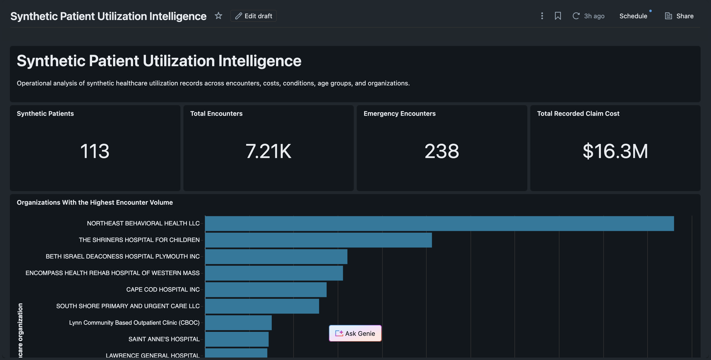
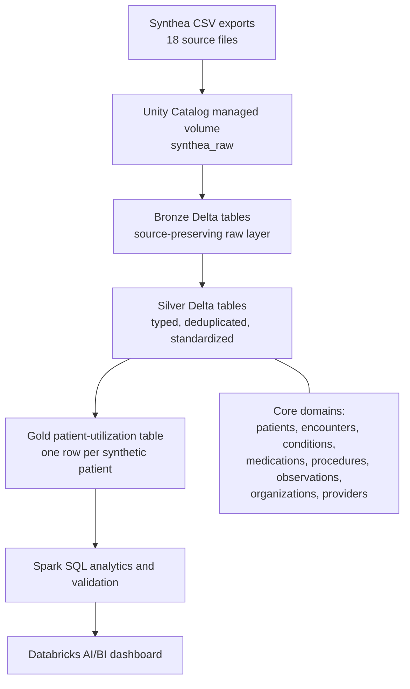
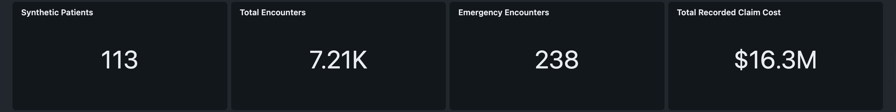
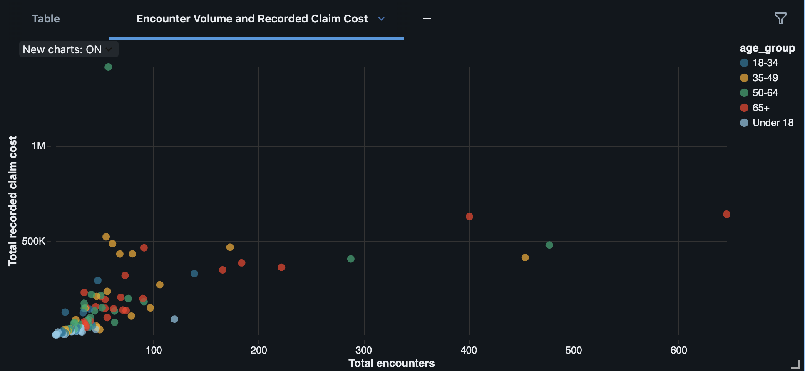
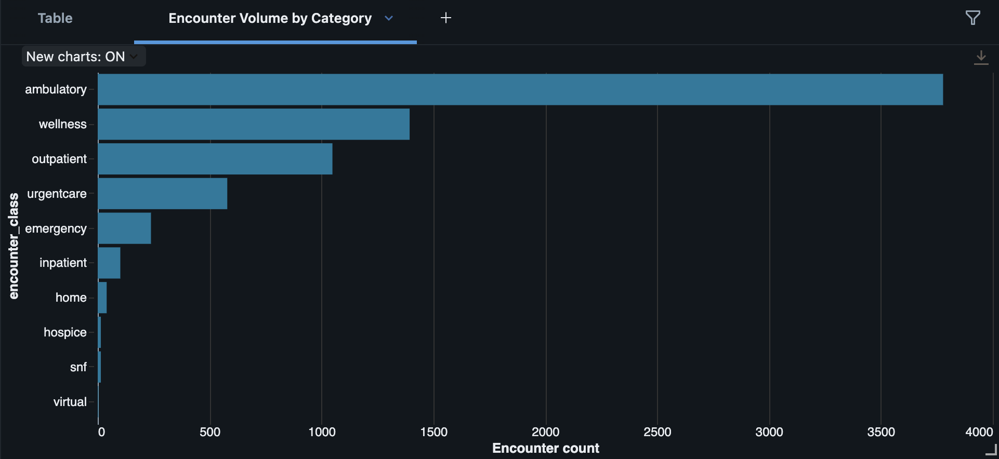
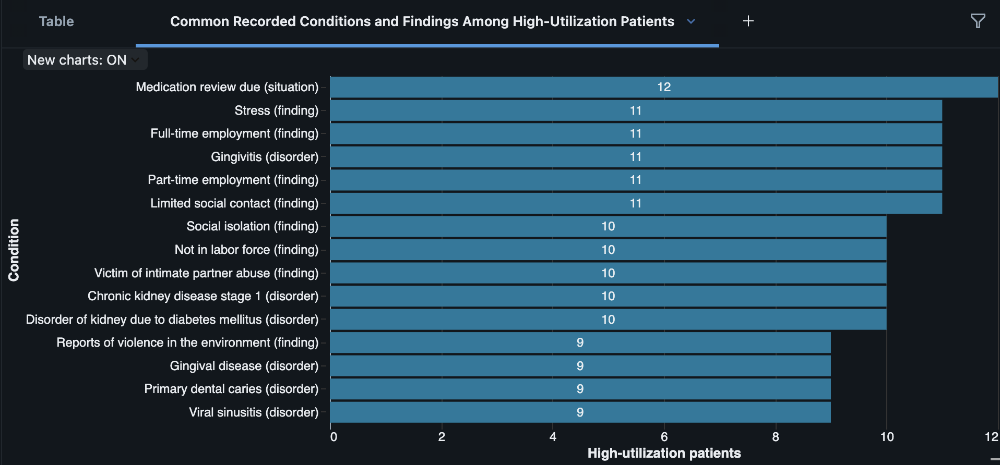

# Synthetic Patient Utilization Intelligence

A Databricks healthcare analytics pipeline that transforms synthetic Synthea records through Bronze, Silver, and Gold layers into patient-level utilization insights and an interactive AI/BI dashboard.



[](https://www.databricks.com/)
[](https://spark.apache.org/)
[](https://delta.io/)
[](https://spark.apache.org/sql/)
[](https://github.com/synthetichealth/synthea)

## Project Snapshot

| Layer or metric | Result |
| --- | ---: |
| Source CSV files uploaded | 18 |
| Core source domains processed | 8 |
| Bronze Delta tables | 8 |
| Silver Delta tables | 8 |
| Gold analytical tables | 1 |
| Synthetic patients | 113 |
| Encounters | 7,210 |
| Observation records | 114,335 |
| Emergency encounters | 238 |

The approximately **$16.3M** total represents synthetic recorded claim costs. It is not real billing, reimbursement, revenue, savings, reduced cost, or verified business impact.

## Problem And Motivation

Healthcare information is often distributed across patient, encounter, condition, medication, procedure, provider, organization, observation, and cost records. This project creates a reproducible healthcare-data pipeline that turns fragmented synthetic records into patient-level utilization intelligence for educational health-informatics, care-management, and healthcare-operations review.

I built this repository to demonstrate system thinking: problem framing, lakehouse architecture, source traceability, data-quality checks, privacy-aware data minimization, analytical modeling, dashboard design, and clear communication of limitations.

## Intended Users And Use Cases

This project is designed for healthcare analysts, data engineering reviewers, AI solutions engineering teams, health-informatics educators, and Databricks reviewers who want to inspect a complete analytics pipeline rather than a one-off notebook.

It can help an analyst explore questions such as:

- How is utilization distributed across age groups?
- Which encounter classes appear most frequently?
- Which synthetic patients have the highest recorded utilization?
- How does encounter volume relate to synthetic recorded claim cost?
- Which conditions and findings appear among high-utilization patients?
- Which organizations recorded the highest encounter volume?

## What I Built

I personally designed the pipeline architecture, set up the Unity Catalog volume, ingested and inventoried the source files, created the Bronze layer, standardized the Silver layer, validated patient and encounter relationships, engineered patient-level utilization features, built the Gold analytical table, wrote the SQL analyses, designed the AI/BI dashboard, established privacy and responsible-use boundaries, and documented findings, limitations, and future work.

## System Architecture



Major design decisions:

- Bronze tables preserve source values and add ingestion metadata.
- Silver tables type dates, timestamps, and numeric fields; standardize labels; deduplicate records; and minimize unnecessary direct identifier-like fields.
- Gold aggregates business-ready patient-level utilization features without turning descriptive metrics into clinical risk scores.
- Analytical outputs use synthetic identifiers instead of names.
- Direct identifier-like fields such as names, synthetic SSNs, passport values, driver-license values, and street addresses are excluded where unnecessary.
- Analytical features are separated from clinical conclusions.

## Bronze-Silver-Gold Data Flow

The pipeline processes eight core Synthea domains: patients, encounters, conditions, medications, procedures, observations, organizations, and providers.

| Layer | Purpose | Output |
| --- | --- | --- |
| Bronze | Preserve raw CSV values and ingestion metadata | `bronze_patients`, `bronze_encounters`, `bronze_conditions`, `bronze_medications`, `bronze_procedures`, `bronze_observations`, `bronze_organizations`, `bronze_providers` |
| Silver | Clean, type, deduplicate, standardize, and limit unnecessary identifiers | `silver_*` tables for the same eight domains |
| Gold | Combine patient, encounter, cost, condition, medication, procedure, organization, and provider features | `gold_patient_utilization` |

## Dataset And Source Attribution

The project uses Synthea-generated synthetic healthcare records. Synthea is an open-source synthetic patient population simulator from the Synthetic Health project. Raw CSV files are intentionally not committed to this public repository.

For reproduction, obtain or generate Synthea CSV data from the official Synthea project and upload the CSV files into a Databricks Unity Catalog volume matching the path pattern documented in [data/README.md](data/README.md). External datasets and third-party platforms remain governed by their own licenses, terms, and access controls.

No real patient information was used.

## Data Model

The Gold model is a patient-level utilization table. Each row represents one synthetic patient and summarizes demographics, encounter activity, emergency and inpatient utilization, repeat encounters within 30 days, recorded claim costs, condition counts, medication counts, procedure counts, and organization/provider touchpoints.

Primary relationship keys include `patient_id`, `encounter_id`, `organization_id`, and `provider_id`. See [docs/data-model.md](docs/data-model.md) for table-level details.

## Data Quality And Validation

The notebooks include validation checks for:

- uploaded file inventory and expected source files;
- table existence, row counts, and column counts;
- missing and duplicate patient identifiers;
- missing and duplicate encounter identifiers;
- encounter-to-patient relationship integrity;
- orphan encounter detection;
- timestamp parsing and negative encounter durations;
- one-row-per-patient Gold validation; and
- reconciliation of Gold encounter totals with the 7,210 Silver encounters.

The visible orphan-encounter result was **0**. Gold was validated as one row per synthetic patient, and Gold encounter totals reconcile to the Silver encounter count. See [docs/quality-and-validation.md](docs/quality-and-validation.md).

## Analytics And Dashboard

The Databricks AI/BI dashboard presents KPI cards and visual exploration of utilization, age-group patterns, encounter classes, recorded claim costs, high-utilization condition/finding concepts, and organization volume.









Dashboard access: no published Databricks dashboard URL was supplied in the source context, so this repository does not claim a public live demo.

## Key Findings

1. Utilization was concentrated among a smaller number of synthetic patients.
2. The 65+ age group recorded the highest average encounter volume.
3. Ambulatory encounters represented the largest encounter category.
4. Recorded claim costs generally increased with encounter volume, but the relationship was not uniform.
5. High-utilization records included disorders, social findings, administrative situations, and environmental observations.
6. Healthcare analytics systems must distinguish diagnoses from observations, situations, and social-context records.

## Privacy And Responsible Use

All patients are synthetic, and no real protected health information was used. Synthetic identifier-like fields can still resemble sensitive data, so this project minimizes unnecessary direct identifiers in analytical outputs and treats public documentation with privacy-aware caution.

This project does not diagnose disease, recommend treatment, determine medical necessity, predict individual clinical outcomes, prioritize real patients, provide validated readmission predictions, or replace clinicians, healthcare analysts, or operational decision-makers. See [docs/responsible-use.md](docs/responsible-use.md).

## Technologies

- Databricks Free Edition
- Apache Spark and PySpark
- Spark SQL
- Delta Lake
- Unity Catalog
- Databricks AI/BI Dashboards
- Python and SQL
- Synthea synthetic healthcare data
- Bronze-Silver-Gold medallion architecture

## Repository Structure

```text
.
├── README.md
├── LICENSE
├── AGENTS.md
├── assets/
├── data/
├── docs/
├── notebooks/
└── scripts/
```

## Reproduction Guide

1. Generate or download Synthea CSV files from the official Synthea project.
2. Upload the CSV files into a Unity Catalog volume such as `/Volumes/workspace/default/synthea_raw/synthea_sample_data_csv_latest`.
3. Import the notebooks in numeric order into Databricks.
4. Run `00_Project_Overview.py` to confirm catalog/schema context and create the volume if needed.
5. Run `01_Data_Ingestion_Bronze.py` through `03_Patient_Utilization_Gold.py` to build the medallion pipeline.
6. Run `04_Utilization_Analytics.py` and `05_Findings_and_Limitations.py` for SQL analysis and documentation outputs.
7. Recreate the AI/BI dashboard from the SQL outputs and Gold table.

See [docs/reproduction-guide.md](docs/reproduction-guide.md) for more detail.

## Limitations

- The data is synthetic and does not represent a real hospital, insurer, health system, geography, or patient population.
- The dataset contains only 113 synthetic patients.
- Recorded claim costs are synthetic and are not validated billing, reimbursement, revenue, savings, or accounting figures.
- Repeat encounters within 30 days are descriptive timing features, not validated readmission measures.
- High-utilization thresholds are descriptive and should not be interpreted as clinical risk scores.
- Condition records may include disorders, findings, situations, social-context concepts, and administrative concepts.
- The analysis identifies associations, not causes.
- Version 1 does not contain a trained machine-learning model.

## Future Work

- Scale the pipeline to a larger Synthea population.
- Add automated data-quality expectations and pipeline monitoring.
- Add dashboard filters for date, age group, encounter class, and organization.
- Evaluate utilization across consistent historical observation windows.
- Add MLflow tracking for a clearly non-clinical utilization-modeling baseline.
- Conduct stakeholder discovery with healthcare analysts before defining production requirements.

## Author

Penuel Stanley-Zebulon
