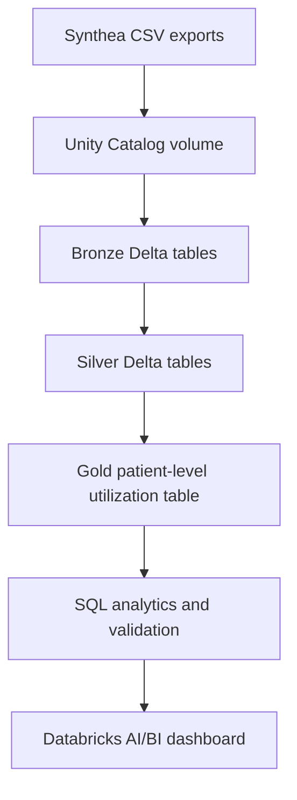

# Architecture

Synthetic Patient Utilization Intelligence follows a Databricks medallion architecture.

## Source Layer

The source files are Synthea-generated CSV exports uploaded into a governed Unity Catalog volume. The project context confirms 18 uploaded CSV files, with the first pipeline version focused on eight core domains: patients, encounters, conditions, medications, procedures, observations, organizations, and providers.

## Bronze Layer

Bronze preserves raw source values as strings and adds ingestion metadata. This makes the original file values traceable before type conversions and business transformations are applied.

## Silver Layer

Silver standardizes column names, converts dates, timestamps, and numeric values, deduplicates records, validates identifiers, checks table relationships, and excludes unnecessary direct identifier-like fields from analytical outputs.

## Gold Layer

Gold creates one row per synthetic patient and summarizes demographics, utilization, recorded claim costs, condition counts, medication counts, procedure counts, and organization/provider touchpoints.

## Presentation Layer

The presentation layer combines SQL analytics, validation outputs, notebook summaries, and a Databricks AI/BI dashboard. The dashboard is designed for operational review, not clinical decision support.

## Design Boundaries

- Source preservation belongs in Bronze.
- Data typing, cleaning, deduplication, and minimization belong in Silver.
- Patient-level analytical features belong in Gold.
- Descriptive utilization features should not be labeled as clinical risk scores.
- Synthetic recorded claim costs should not be described as real billing, reimbursement, revenue, savings, or business impact.
